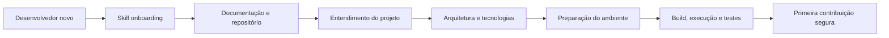
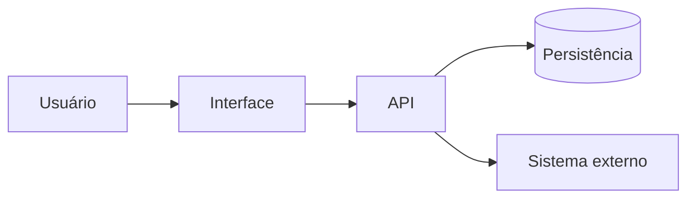
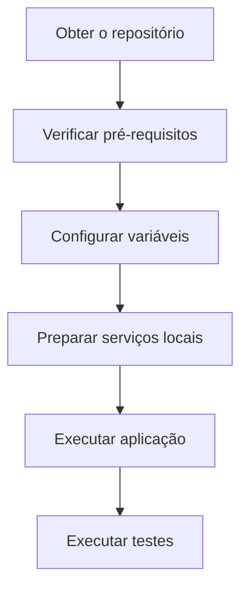
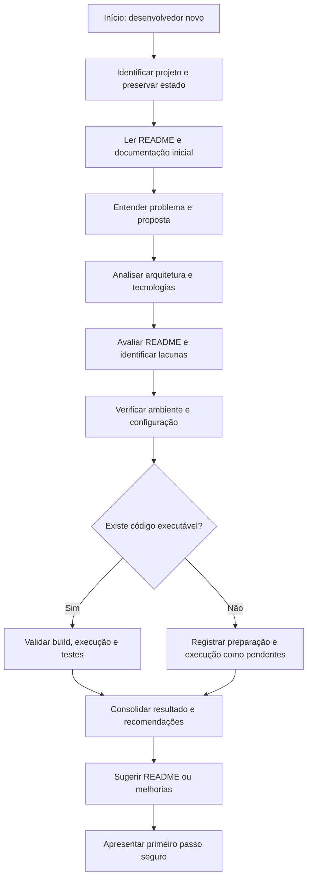
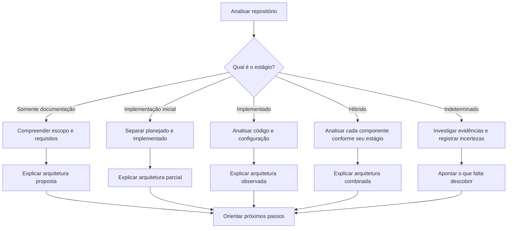

# Skill `onboarding`
## Guia de apresentação, conceitos e utilização — versão 1.3.0

> **Uma entrada simples para compreender um projeto, preparar o ambiente e começar a contribuir com segurança.**

A Skill `onboarding` orienta uma pessoa desenvolvedora que ainda não conhece um projeto de software. Ela investiga a documentação e o repositório, explica o problema que o projeto pretende resolver, apresenta a arquitetura e as tecnologias disponíveis e identifica o caminho mais seguro para começar a trabalhar.

Seu princípio central é simples:

**O desenvolvedor não deve precisar descobrir sozinho como entender e executar o projeto. O onboarding deve transformar as informações existentes em um caminho claro, verificável e prático para começar.**

Este README também foi organizado como material-base para estudo e criação de apresentações no Google NotebookLM. Seus conceitos, diagramas e fluxos podem ser utilizados como fonte de conteúdo.

---

## 1. Visão geral

### O que é a Skill

A `onboarding` é uma capacidade especializada, independente e agnóstica de tecnologia, que conduz o onboarding técnico inicial de uma pessoa desenvolvedora em um projeto.

Ela utiliza o `README.md` como principal ponto de entrada e consulta os demais documentos e arquivos do repositório para validar e complementar as informações.

A Skill funciona em diferentes estágios de maturidade:

- Repositórios que possuem somente documentação.
- Projetos em fase inicial de implementação.
- Projetos parcialmente implementados.
- Sistemas já implementados, com build, execução e testes disponíveis.

### Objetivo principal

Reduzir o tempo e a incerteza necessários para que uma pessoa nova consiga:

1. Entender o problema e a proposta de solução.
2. Compreender a arquitetura e os principais componentes.
3. Identificar as tecnologias utilizadas ou planejadas.
4. Preparar o ambiente local.
5. Configurar as variáveis necessárias.
6. Executar o build, a aplicação e os testes, quando aplicável.
7. Identificar pendências e começar a contribuir com segurança.

### O que a Skill não pretende ser

A Skill não é:
- um processo completo de integração organizacional ou de gestão de pessoas;
- um curso de todas as tecnologias do projeto;
- uma ferramenta de instalação automática de dependências;
- um mecanismo de criação ou alteração automática de código;
- uma auditoria formal de arquitetura, segurança ou qualidade;
- uma substituta da documentação especializada do projeto.

Seu foco é o **onboarding técnico essencial para começar a trabalhar**.

---

## 2. O problema que a Skill resolve

Quando uma pessoa desenvolvedora entra em um projeto desconhecido, normalmente precisa descobrir por conta própria:

- Para que serve o projeto?
- Qual problema ele resolve?
- Como a solução foi pensada?
- Quais são os principais componentes?
- Quais tecnologias e versões são utilizadas?
- Como preparar o ambiente local?
- Quais variáveis de ambiente são necessárias?
- Como executar a aplicação?
- Como compilar e executar os testes?
- Onde começar a contribuir?

Essas informações podem estar espalhadas em documentos, arquivos de configuração, scripts e código-fonte. Em alguns projetos, sequer existe um README adequado.

O resultado pode ser um onboarding lento, dependente de explicações informais e sujeito a interpretações incorretas.

### Antes e depois

| Sem um onboarding orientado | Com a Skill `onboarding` |
|---|---|
| Desenvolvedor procura informações sem uma sequência clara | Existe um fluxo orientado de investigação |
| README pode estar ausente ou incompleto | README é analisado e suas lacunas são identificadas |
| Arquitetura precisa ser descoberta de forma dispersa | Componentes e fluxos são organizados e explicados |
| Comandos de execução são encontrados por tentativa e erro | Comandos são identificados em fontes reais e validados quando possível |
| Variáveis e dependências podem gerar dúvidas | Configuração local é explicada sem expor segredos |
| Projeto sem código parece não permitir onboarding | Documentação permite compreender a solução planejada |
| Dúvidas e bloqueios ficam dispersos | Pendências e primeiro passo são apresentados claramente |

### Fluxo conceitual



> O fluxo é adaptativo: quando não existe código, as etapas de build, execução e testes são identificadas como não aplicáveis ou pendentes, sem impedir o onboarding documental.

---

## 3. Conceitos fundamentais

### 3.1 README como ponto de entrada

O README é o principal guia de entrada do projeto. Deve oferecer uma visão concisa e prática para que uma pessoa nova compreenda o sistema e saiba como começar.

A Skill analisa o README existente e verifica se ele responde às perguntas essenciais. Quando não existe, sugere uma estrutura inicial. Quando está incompleto, aponta lacunas e propõe melhorias.

O README não deve duplicar toda a documentação. Deve apresentar o essencial e direcionar para documentos especializados quando necessário.

### 3.2 Documentação como fonte de evidências

A Skill consulta documentos e arquivos que ajudem a compreender o projeto. A sequência inicial é:

1. `README.md`, se existir.
2. `CLAUDE.md`, se existir.
3. `CHECKLISTS.md`, se existir.
4. Documentação de arquitetura, se existir.

Também pode consultar escopo, requisitos, histórias, critérios de aceite, ADRs, diagramas, manifests, scripts de build e configuração de testes.

A Skill informa quais arquivos efetivamente leu. Localizar um arquivo não significa que seu conteúdo foi analisado.

### 3.3 Evidência, inferência e desconhecido

Uma boa explicação do projeto não deve transformar suposições em fatos.

| Classificação | Significado |
|---|---|
| Documentado | Informação encontrada em documentação |
| Observado | Informação confirmada no código ou configuração |
| Executado | Resultado de comando realmente executado |
| Inferido | Interpretação plausível ainda não confirmada |
| Desconhecido | Informação sem evidência suficiente |
| Planejado | Decisão ou tecnologia prevista, ainda não implementada |

Essa distinção é especialmente importante em projetos que ainda não possuem código.

### 3.4 Arquitetura proposta versus implementada

A documentação pode descrever uma solução futura. O código demonstra o que existe atualmente.

A Skill deve deixar explícita essa diferença:

- **Arquitetura proposta:** descrita em documentos, diagramas ou decisões, mas ainda não implementada.
- **Arquitetura implementada:** observada no código, configurações e integrações existentes.
- **Arquitetura híbrida:** parte implementada e parte planejada.

Diagramas Mermaid devem refletir as evidências. Elementos hipotéticos precisam ser identificados como propostas ou hipóteses.

### 3.5 Ambiente reproduzível

O onboarding deve explicar como preparar o ambiente de desenvolvimento utilizando os mecanismos já adotados pelo projeto.

Quando o repositório oferece Dockerfile, Compose ou outra configuração de containers, a Skill pode orientar seu uso. Não deve introduzir containers como requisito em projetos que não os utilizam.

### 3.6 Segurança e preservação

A Skill orienta e verifica o que for seguro, mas não instala tudo automaticamente nem executa ações destrutivas.

Ela:
- preserva alterações locais;
- não sobrescreve arquivos sem autorização;
- não revela valores de segredos;
- inspeciona comandos antes de executá-los;
- solicita autorização para ações com efeitos colaterais relevantes;
- não executa deploy, publicação ou operações destrutivas como parte do onboarding.

---

## 4. Conteúdo mínimo recomendado para o README

A Skill utiliza o seguinte conjunto de informações como referência para avaliar a documentação de entrada.

| Seção | Pergunta que responde | Conteúdo esperado |
|---|---|---|
| Sobre o projeto | Para que serve? | Problema, contexto e proposta de solução |
| Arquitetura | Como a solução está organizada? | Componentes, responsabilidades, fluxos e diagrama Mermaid |
| Tecnologias | O que será utilizado? | Linguagens, frameworks, serviços e ferramentas |
| Pré-requisitos | O que preciso ter instalado? | Ferramentas e versões confirmadas |
| Ambiente local | Como preparo e inicio? | Passos de configuração e execução |
| Containers | Como subir os serviços locais? | Instruções existentes de Docker/Compose ou equivalentes |
| Configuração | Quais variáveis preciso configurar? | Nomes, finalidade, obrigatoriedade e exemplos seguros |
| Build e execução | Como compilar e iniciar? | Comandos confirmados |
| Testes | Como validar? | Tipos de testes e comandos disponíveis |
| Estrutura | Onde encontro cada parte? | Diretórios e módulos relevantes |
| Documentação complementar | Onde aprofundo? | Links para requisitos, arquitetura e decisões |

Nem todas as seções serão aplicáveis em todos os estágios. Em um repositório sem código, por exemplo, build e testes podem estar definidos como pendentes.

### Exemplo de arquitetura em Mermaid

O exemplo abaixo é ilustrativo. A Skill deve produzir diagramas com os componentes efetivamente documentados ou observados no projeto.



### Exemplo de fluxo local

Também ilustrativo; os passos reais devem ser descobertos no projeto.



---

## 5. Fluxo de trabalho da Skill

O processo é organizado em etapas simples. A ordem pode ser adaptada conforme o estágio do projeto e as evidências disponíveis.



### Etapa 1 — Identificar e preservar

A Skill delimita o repositório e verifica seu estado. Se Git estiver disponível, pode consultar `git status` para identificar alterações locais que devem ser preservadas.

### Etapa 2 — Ler documentação

Começa pelo README e pelos documentos iniciais disponíveis. Depois consulta materiais complementares relevantes.

O resultado deve informar:
- arquivos lidos;
- arquivos lidos parcialmente;
- arquivos localizados, mas não lidos;
- arquivos ausentes ou inacessíveis.

### Etapa 3 — Compreender o projeto

Organiza as informações sobre:
- problema;
- proposta de solução;
- escopo;
- arquitetura;
- componentes;
- tecnologias;
- dependências e integrações relevantes.

### Etapa 4 — Avaliar o README

Verifica se o README permite que um desenvolvedor novo compreenda o projeto e comece a trabalhar.

A avaliação identifica se cada informação está atendida, parcial, ausente ou não aplicável.

### Etapa 5 — Preparar o ambiente

Identifica pré-requisitos, configuração local, containers quando existentes, variáveis de ambiente e comandos necessários.

Não instala ou atualiza ferramentas automaticamente.

### Etapa 6 — Validar execução

Quando há código e condições seguras, inspeciona e pode executar build, aplicação e testes. Registra comandos e resultados reais.

### Etapa 7 — Consolidar o onboarding

Apresenta a visão geral, documentação consultada, arquitetura, tecnologias, instruções de início, lacunas e primeiro passo recomendado.

### Etapa 8 — Propor melhorias no README

Quando necessário, apresenta uma proposta de criação ou revisão. A gravação no repositório depende de pedido ou autorização explícita.

---

## 6. Fluxo adaptativo por estágio do projeto

Uma característica essencial da Skill é não exigir que o projeto esteja implementado para que o onboarding aconteça.



| Estágio | O que a Skill prioriza | O que não deve presumir |
|---|---|---|
| Documentação apenas | Problema, proposta, requisitos e arquitetura planejada | Código, stack não decidida, comandos de execução |
| Implementação inicial | O que já existe e o que está planejado | Que toda a arquitetura está implementada |
| Implementado | Stack, ambiente, build, execução e testes | Que a documentação está atualizada |
| Híbrido | Diferenças entre componentes planejados e existentes | Que todos os componentes têm o mesmo estágio |
| Indeterminado | Investigação e registro de incertezas | Uma classificação sem evidências |

### Onboarding em repositório sem código

Nesse cenário, o desenvolvedor ainda pode compreender:
- por que o projeto existe;
- qual problema pretende resolver;
- qual solução está sendo proposta;
- quais componentes estão previstos;
- quais tecnologias já foram decididas;
- quais decisões ainda precisam ser tomadas.

A Skill pode sugerir um README inicial, mas não inventa stack, build, variáveis ou instruções de execução.

---

## 7. Ambiente local: o que deve ser explicado

O README deve orientar o desenvolvedor a preparar o ambiente com o mínimo de tentativa e erro.

### Pré-requisitos

Listar ferramentas e versões efetivamente necessárias, conforme manifests, scripts e documentação.

### Containers

Se o projeto já oferece configuração de containers:
- identificar os serviços definidos;
- explicar como iniciar e verificar os serviços;
- indicar portas e dependências confirmadas;
- explicar como encerrar o ambiente sem remover volumes ou dados indevidamente.

A Skill não deve introduzir Docker ou Compose por conta própria.

### Variáveis de ambiente

A documentação deve explicar:

| Informação | Exemplo de descrição |
|---|---|
| Nome | `APP_PROFILE` |
| Finalidade | Perfil de execução da aplicação |
| Obrigatória | Sim, se confirmado |
| Exemplo seguro | `local` |
| Origem | Documentação ou configuração que comprova o uso |

Os exemplos são ilustrativos. A Skill deve descobrir os nomes reais e nunca exibir valores secretos encontrados em arquivos locais.

### Build, execução e testes

Os comandos devem ser encontrados em fontes reais, como:
- scripts do projeto;
- manifests;
- Makefile;
- wrappers;
- documentação;
- configuração de CI.

A Skill não deve inventar comandos nem declarar sucesso sem execução efetiva.

---

## 8. Relatório de onboarding

O resultado do onboarding deve ser organizado, conciso e acionável. O modelo está disponível em `assets/RESUMO-ONBOARDING.template.md`.

A estrutura sugerida é:

1. **Visão geral:** problema, proposta e estágio do projeto.
2. **Documentação consultada:** arquivos e status de leitura.
3. **Arquitetura:** componentes, fluxos e diagrama Mermaid.
4. **Tecnologias:** confirmadas, planejadas e ainda não decididas.
5. **Como começar:** pré-requisitos, ambiente, variáveis, build, execução e testes.
6. **Avaliação do README:** conteúdo atendido, parcial, ausente ou não aplicável.
7. **Pendências:** bloqueios e primeiro passo recomendado.

O relatório deve separar o que foi documentado, observado, executado, inferido e desconhecido.

---

## 9. Vantagens e benefícios esperados

### Para o desenvolvedor

- Menor tempo para entender o projeto.
- Visão mais clara do problema e da solução.
- Compreensão visual da arquitetura.
- Menos dúvidas para preparar o ambiente.
- Instruções de build, execução e testes mais acessíveis.
- Maior segurança para começar a contribuir.

### Para o projeto e a equipe

- README mais útil e consistente.
- Menor dependência de explicações informais.
- Lacunas documentais identificadas mais cedo.
- Maior clareza entre arquitetura planejada e implementada.
- Processo de entrada mais repetível.
- Preservação de conhecimento técnico.

### Para projetos novos

- Onboarding possível antes da primeira linha de código.
- Escopo e arquitetura apresentados de forma compreensível.
- Decisões ainda pendentes explicitadas.
- README inicial orientado à futura implementação.

> Esses são benefícios esperados do uso da Skill, não resultados quantitativos garantidos. A medição de ganhos depende de acompanhamento em projetos reais.

---

## 10. Independência e portabilidade

A Skill é autocontida e pode ser utilizada isoladamente em qualquer repositório ou ambiente compatível com Agent Skills.

Não depende de:
- harness específico;
- outra Skill;
- workflow externo;
- linguagem ou framework;
- sistema operacional;
- ferramenta de containers;
- fornecedor ou agente de IA.

Ela descobre as tecnologias e ferramentas existentes em vez de impor uma stack ou estrutura.

---

## 11. Salvaguardas e limites de atuação

A Skill orienta, verifica e apresenta recomendações. Não assume controle irrestrito do ambiente.

| Ação | Comportamento |
|---|---|
| Ler documentação e código | Permitido dentro do escopo |
| Consultar estado do Git | Permitido, sem alterar o repositório |
| Verificar versões e ferramentas | Preferencialmente somente leitura |
| Instalar dependências ou ferramentas | Solicitar autorização |
| Iniciar serviços e containers | Avaliar efeitos e solicitar autorização quando relevante |
| Alterar arquivos do projeto | Exigir pedido ou autorização explícita |
| Criar ou atualizar README | Apresentar proposta antes de gravar |
| Exibir segredos | Nunca |
| Apagar dados, volumes ou arquivos | Não executar como parte do onboarding |
| Deploy, publicação ou operação em ambiente compartilhado | Fora do escopo do onboarding |

Uma autorização para uma ação não autoriza automaticamente outras ações subsequentes.

---

## 12. Estrutura da Skill

```text
onboarding/
├── SKILL.md
├── README.md
├── CHANGELOG.md
├── references/
│   ├── checklist-readme.md
│   ├── evidencias-e-seguranca.md
│   ├── estagios-do-projeto.md
│   └── principios-e-fontes.md
└── assets/
    ├── README.template.md
    └── RESUMO-ONBOARDING.template.md
```

| Arquivo | Responsabilidade |
|---|---|
| `SKILL.md` | Instruções operacionais e fluxo da Skill |
| `README.md` | Conceitos, objetivos, fluxos e guia de apresentação |
| `checklist-readme.md` | Critérios para avaliar o README |
| `evidencias-e-seguranca.md` | Evidências, execução segura e proteção de segredos |
| `estagios-do-projeto.md` | Adaptação ao estágio do projeto |
| `principios-e-fontes.md` | Princípios e referências |
| `README.template.md` | Estrutura inicial de README para um projeto |
| `RESUMO-ONBOARDING.template.md` | Estrutura concisa do resultado |

---

## 13. Como utilizar

O prompt de ativação pode ser simples:

```text
Sou novo neste projeto. Faça meu onboarding.
```

A pessoa desenvolvedora não precisa informar previamente:
- linguagem;
- framework;
- arquitetura;
- comandos de build;
- ferramentas;
- estrutura do repositório.

A Skill investiga essas informações e conduz o processo de acordo com o que encontrar.

### Exemplo de resultado esperado

Ao final, o desenvolvedor deve conseguir responder:

- Qual problema este projeto resolve?
- Qual é a proposta de solução?
- Como a arquitetura está organizada?
- Quais tecnologias são utilizadas ou planejadas?
- Como preparar o ambiente local?
- Como configurar as variáveis necessárias?
- Como executar build, aplicação e testes?
- O que ainda falta saber?
- Qual é o primeiro passo seguro para contribuir?

---

## 14. Referências e fundamentos

A Skill adota práticas gerais de documentação, configuração, visualização e segurança. As referências abaixo são fontes de consulta, não requisitos tecnológicos impostos ao projeto.

- [GitHub — About READMEs](https://docs.github.com/en/repositories/managing-your-repositorys-settings-and-features/customizing-your-repository/about-readmes)
- [GitLab — Markdown](https://docs.gitlab.com/user/markdown/)
- [Mermaid — Documentação](https://mermaid.js.org/intro/)
- [The Twelve-Factor App — Config](https://12factor.net/config)
- [OWASP — Secrets Management Cheat Sheet](https://cheatsheetseries.owasp.org/cheatsheets/Secrets_Management_Cheat_Sheet.html)
- [Agent Skills Specification](https://agentskills.io/specification)

---

## 15. Mensagem central

A Skill `onboarding` transforma a documentação e as evidências de um repositório em um caminho de entrada claro para quem ainda não conhece o projeto.

**Compreender o problema. Visualizar a solução. Preparar o ambiente. Executar com segurança. Começar a contribuir.**

Esse é o propósito do onboarding.
