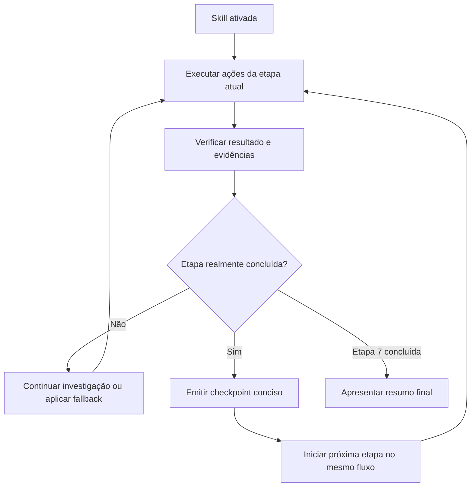
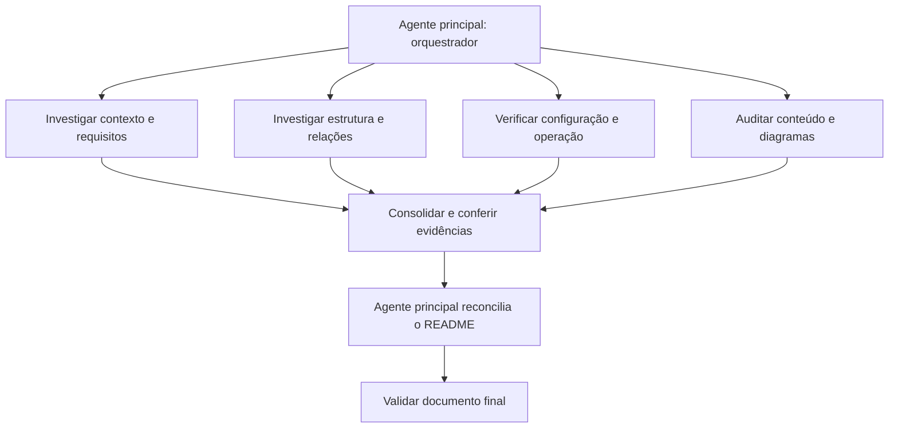

# Skill `onboarding`

## Guia didático, fluxo operacional e decisões de projeto — versão 1.9.0

A Skill `onboarding` investiga qualquer tipo de repositório e cria ou reconcilia seu `README.md` para torná-lo uma porta de entrada confiável e visual. O foco da versão 1.9.0 é **executar o trabalho e informar resultados reais ao concluir cada etapa**, sem transformar o progresso em uma atividade separada.

> **Princípio central:** o agente deve fazer o onboarding, não apenas anunciar que vai fazê-lo.

## 1. O que a Skill entrega

A Skill investiga as fontes atuais, compreende o propósito e o estado do projeto, identifica como uma pessoa nova pode começar e reconcilia o README com o que está comprovado. O resultado é um documento persistente no próprio repositório, e não apenas uma explicação temporária no chat.

Entregas típicas:

- problema, proposta, público e estágio do projeto;
- estrutura, artefatos, relações e fluxos relevantes;
- preparação, configuração, uso e validação, quando aplicáveis;
- avaliação factual, estrutural e visual do README;
- diagramas Mermaid quando ajudam a explicar relações reais;
- validação final e resumo das mudanças, justificativas e limitações.

A Skill não instala dependências, provisiona infraestrutura, altera código funcional, muda configurações de agentes nem realiza uma auditoria de segurança completa. Sua escrita fica limitada ao README-alvo.

## 2. Independência tecnológica

A Skill não presume linguagem, framework, arquitetura, runtime, sistema operacional, provedor, banco de dados, ferramenta de versionamento ou pipeline. Também não presume que o repositório contenha código ou seja uma aplicação executável.

Pode ser aplicada a aplicações, bibliotecas, dados, documentação, pesquisa, automações, infraestrutura, firmware, hardware, protótipos, especificações e projetos em qualquer estágio.

| Não presume | Faz em vez disso |
|---|---|
| Código-fonte | Identifica os tipos de artefatos existentes. |
| Arquitetura de software | Descreve a organização e as relações adequadas ao domínio. |
| Build ou testes | Verifica se existem e se são pertinentes. |
| Docker ou containers | Documenta somente ambiente existente. |
| Git | Usa se disponível; se não, preserva o estado por outros meios. |
| Subagentes | Descobre capacidades efetivamente invocáveis na sessão. |
| Uma estrutura fixa de README | Escolhe seções pertinentes à natureza do projeto. |

A neutralidade tecnológica não significa omitir tecnologias encontradas. Significa não impô-las como pré-requisitos universais.

## 3. Por que remover a barra de progresso

As execuções reais mostraram que a barra, as porcentagens e a mensagem inicial de status podiam ocupar a primeira resposta do agente sem que o trabalho tivesse começado. Em uma ocorrência, o agente anunciou `0/9` e encerrou a interação após carregar a Skill; em outras, reuniu várias barras em uma única saída.

A informação de quantas etapas faltam não é tão útil quanto saber o que foi efetivamente concluído. Por isso, a versão 1.9.0 remove:

- barra textual ou gráfica;
- percentuais e contagem regressiva;
- mensagem inicial de progresso;
- atualizações repetitivas durante a etapa sem resultados novos.

Em seu lugar, a Skill envia um checkpoint curto **depois que cada etapa é executada e verificada**. A comunicação deixa de ser o objetivo e passa a ser um registro conciso do trabalho realizado.

## 4. Regra de execução: ação primeiro, comunicação depois

Após a ativação, o agente começa imediatamente pela inspeção real do workspace. Não deve responder apenas com um plano, “iniciando onboarding”, uma barra ou uma confirmação.

A sequência é:



A mensagem do checkpoint não é uma resposta final, não pede autorização e não deve terminar o turno do agente enquanto houver trabalho pendente. Após comunicá-la, o agente inicia imediatamente a próxima ação/ferramenta no mesmo fluxo de execução.

### Exemplo de checkpoint

> Etapa 1/7 concluída — README-alvo e estado local identificados; alterações preexistentes preservadas e recursos de delegação verificados. Próxima: investigar as fontes do projeto.

O exemplo é uma mensagem isolada emitida após o trabalho correspondente. Não é um texto a ser pré-gerado junto com os outros checkpoints.

**Primeiro fazer, depois informar.** Carregar a Skill, criar um plano ou listar arquivos não significa que uma etapa foi concluída.

## 5. As sete etapas de trabalho

As fases agrupam atividades que fazem sentido juntas. Isso reduz a cerimônia de comunicação sem eliminar a cobertura necessária.

| Etapa | Foco | Resultado esperado |
|---|---|---|
| 1. Escopo, preservação e recursos | Localizar repositório e README, compreender instruções, preservar mudanças locais e descobrir delegação disponível. | Alvo e limites definidos. |
| 2. Investigação e evidências | Examinar fontes primárias e delegar frentes independentes quando isso trouxer ganho real. | Evidências verificáveis coletadas. |
| 3. Compreensão do projeto | Consolidar problema, proposta, público, estágio, estrutura e relações. | Entendimento coerente do projeto. |
| 4. Preparação e operação | Verificar pré-requisitos, parâmetros, uso, build/testes e validações quando aplicáveis. | Procedimentos sustentados por fontes. |
| 5. Auditoria do README | Confrontar conteúdo, organização, legibilidade, diagramas e navegação com o estado atual. | Lacunas e oportunidades justificadas. |
| 6. Reconciliação do README | Criar/atualizar o documento ou comprovar que nenhuma mudança material é necessária. | README reconciliado. |
| 7. Validação e entrega | Relê o documento final e executa verificações pós-edição. | Resultado confiável e resumo. |

### O que informar em cada checkpoint

Use uma linha, idealmente com:

- número e nome da etapa concluída;
- um ou dois fatos/artefatos que comprovem o resultado;
- nome da próxima etapa.

Evite copiar listas longas de arquivos, narrar cada comando, imprimir percentuais ou repetir todo o plano. Se uma atividade não se aplica, o checkpoint deve dizer brevemente por quê.

## 6. Orquestração de subagentes

Na primeira etapa, o agente identifica as capacidades reais da ferramenta. Durante a investigação, pode distribuir leituras independentes entre subagentes especializados — por exemplo, contexto e requisitos, estrutura/arquitetura, ambiente/operação ou qualidade visual — quando a ferramenta oferecer essa capacidade e as permissões permitirem.



Os subagentes recebem tarefas delimitadas, preferencialmente somente leitura. O orquestrador verifica os achados nas fontes originais e é o único responsável por editar o README. Arquivos de configuração no repositório não provam, por si só, que um agente pode ser invocado. Se não houver delegação útil, a execução direta continua sem interrupção.

## 7. Auditoria visual e Mermaid

A Skill verifica sempre se o README pode ficar mais claro visualmente, sem adicionar diagramas por quantidade. A pergunta que deve ser respondida na auditoria e no resumo final é:

> **O README.md do projeto pode ser melhorado com mais diagramas Mermaid para tornar mais visual, fácil de ver e entender?**

A resposta deve ser **SIM** ou **NÃO**, com justificativa concreta.

Algumas perguntas que diagramas podem responder:

- Quais elementos fazem parte da solução e como se relacionam? → `flowchart`.
- Em que ordem atores/sistemas trocam mensagens? → `sequenceDiagram`.
- Quais estados e transições existem? → `stateDiagram`.
- Como uma pessoa prepara ou executa o projeto? → `flowchart`.
- Como artefatos, conjuntos de dados ou módulos se organizam? → `flowchart` ou `classDiagram`, se apropriado.

Use nomes reais e relações sustentadas por evidências. Diagrama proposto deve ser identificado como planejado. Não crie fluxos genéricos, redundantes ou decorativos.

## 8. Segurança e preservação

- O pedido de onboarding autoriza escrita somente no README-alvo.
- Não altere código, outros documentos, dados, configurações ou arquivos de agentes.
- Preserve mudanças locais existentes e não as sobrescreva silenciosamente.
- Não exponha tokens, senhas, chaves, certificados ou valores sensíveis.
- Inspecione comandos antes de executá-los e evite efeitos externos.
- Respeite aprovações obrigatórias do runtime; não as contorne.

## 9. Critérios para concluir

A execução só pode ser considerada concluída quando:

1. as sete etapas foram executadas ou itens não aplicáveis foram justificados;
2. o README foi comparado com evidências atuais nesta execução;
3. a pergunta Mermaid foi respondida SIM/NÃO e justificada;
4. o README foi atualizado e validado, ou nenhuma mudança material foi comprovada;
5. as validações finais ocorreram depois da reconciliação;
6. o escopo de escrita foi respeitado.

Estados finais possíveis:

- `CONCLUÍDO — README atualizado`;
- `CONCLUÍDO — nenhuma alteração necessária`;
- `INCOMPLETO — README não reconciliado`;
- `SOMENTE ANÁLISE — escrita não autorizada`.

Se o cliente não transmitir checkpoints de forma intermediária, isso deve ser declarado sem simular streaming. A limitação de comunicação, por si só, não é motivo para parar o onboarding.

## 10. Como utilizar

O pedido pode ser natural e curto, por exemplo:

```text
Execute a skill @onboarding e atualize o README.md do projeto.
```

O agente deve localizar o repositório, executar as sete etapas, informar cada etapa concluída e terminar o trabalho sem exigir comandos de continuação.

## 11. Estrutura do pacote

```text
onboarding/
├── SKILL.md
├── README.md
├── CHANGELOG.md
├── assets/
│   ├── README.template.md
│   └── RESUMO-ONBOARDING.template.md
├── evals/
│   ├── README.md
│   └── evals.json
└── references/
    ├── checklist-readme.md
    ├── diagramas-mermaid.md
    ├── estagios-do-projeto.md
    ├── evidencias-e-seguranca.md
    ├── execucao-continua.md
    ├── orquestracao-multiagentes.md
    ├── principios-e-fontes.md
    └── progresso-e-conclusao.md
```

## 12. Evolução da versão 1.9.0

- Removida a barra de progresso, percentuais, contagem regressiva e mensagem inicial de status.
- Mensagens substituídas por checkpoints de conclusão, emitidos somente após trabalho e verificação reais.
- Tornado obrigatório iniciar a inspeção do repositório logo após a ativação, sem terminar a resposta com apenas um anúncio.
- Checkpoint definido como mensagem intermediária: após emiti-lo, o agente deve iniciar a etapa seguinte no mesmo fluxo, sem aguardar o usuário.
- Nove etapas detalhadas agrupadas em sete fases de trabalho com resultados claros.
- Avaliações atualizadas para detectar especificamente a falha de interromper após a primeira mensagem.
- Mantidas a independência tecnológica, a reconciliação obrigatória do README, a avaliação Mermaid e a orquestração multiagente segura.

## 13. Conformidade com Agent Skills

A estrutura segue o formato aberto Agent Skills: diretório da Skill, `SKILL.md` com frontmatter YAML, recursos auxiliares em `references/`, modelos em `assets/` e avaliações em `evals/`. O `SKILL.md` contém apenas identidade, contrato de execução, fases, critérios críticos e roteamento para referências sob demanda.

Fontes oficiais:

- [Visão geral do Agent Skills](https://agentskills.io/home)
- [Especificação do formato](https://agentskills.io/specification)
- [Boas práticas de criação](https://github.com/agentskills/agentskills/blob/main/docs/skill-creation/best-practices.mdx)

O formato define como empacotar e instruir uma Skill, mas não define uma API universal de streaming. A entrega de mensagens intermediárias depende do cliente em uso. A suíte de avaliações precisa ser executada nos clientes-alvo para validar esse comportamento.
