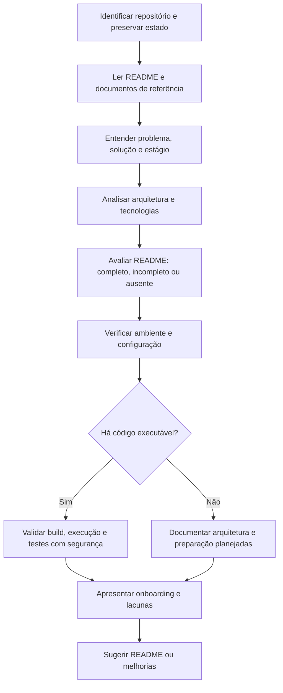

# Onboarding de desenvolvedor

## Objetivo

Ajudar uma pessoa desenvolvedora que não conhece o projeto a entender rapidamente **o que será construído, como a solução está organizada e como começar a trabalhar nela com segurança**.

O README.md é o principal ponto de entrada do onboarding. A Skill deve analisá-lo, verificar se contém o mínimo necessário e, quando estiver ausente ou incompleto, propor sua criação ou melhoria com base nas evidências disponíveis.

A Skill é independente e agnóstica: não pressupõe linguagem, framework, sistema operacional, arquitetura, ferramentas, estrutura de diretórios, harness ou agente.

## Resultado esperado

Ao final, o desenvolvedor deve ter:
1. Uma explicação concisa do problema, da proposta de solução e do estágio do projeto.
2. Uma visão da arquitetura, preferencialmente com diagramas Mermaid renderizáveis no Markdown.
3. Conhecimento das tecnologias e dos principais componentes, quando definidos.
4. Instruções confiáveis para preparar o ambiente local, configurar variáveis, executar build, aplicação e testes, quando aplicável.
5. Uma lista objetiva de lacunas, bloqueios e próximos passos para começar a contribuir.

## Princípios

- **README primeiro:** trate o README.md como o guia de entrada. Consulte documentação complementar para validar e completar seu conteúdo.
- **Investigue antes de perguntar:** explore o repositório e a documentação antes de solicitar informações.
- **Evidência antes de afirmação:** diferencie informação documentada, observada no código, inferida e desconhecida.
- **Não invente:** não crie tecnologias, comandos, portas, variáveis, componentes, conexões ou requisitos sem evidência.
- **Proposta versus realidade:** em repositórios sem código, identifique arquitetura e tecnologias como propostas/planejadas; nunca as descreva como implementadas.
- **Concisão:** README deve permitir começar. Detalhes extensos podem permanecer em documentos especializados, referenciados por links.
- **Segurança:** não revele segredos, não execute ações destrutivas e peça autorização antes de alterações ou ações com efeitos colaterais.
- **Preservação:** não sobrescreva alterações locais nem substitua conteúdo útil sem comparar e explicar a mudança.
- **Independência:** esta Skill pode ser usada isoladamente; não dependa de outras Skills ou workflows.

## Processo

### 1. Identificar o projeto e preservar o estado

- Confirme o diretório/repositório alvo; pergunte apenas se houver ambiguidade.
- Identifique o estágio: documentação apenas, implementação inicial, implementado, híbrido ou indeterminado.
- Se Git estiver disponível, consulte `git status --short --branch` antes de qualquer ação que possa alterar arquivos.
- O escopo padrão é análise e orientação. Não altere arquivos nesta etapa.

### 2. Ler e informar as fontes consultadas

Comece por:
1. `README.md`, se existir;
2. `CLAUDE.md`, se existir;
3. `CHECKLISTS.md`, se existir;
4. documentação de arquitetura, se existir.

Depois consulte, conforme a necessidade, documentos de visão/escopo, requisitos, histórias, critérios de aceite, ADRs, diagramas, glossário, instruções de desenvolvimento, manifests, scripts de build e configuração de testes.

- Descubra os caminhos reais; não exija diretórios ou nomes fixos.
- Informe os arquivos efetivamente lidos, distinguindo: lido, parcial, localizado mas não lido, ausente ou inacessível.
- Não declare um arquivo como lido apenas por tê-lo localizado.
- Respeite `.gitignore` e evite explorar dependências, builds, caches, dumps e dados volumosos.
- Se houver conflito entre documentos e código, registre a divergência; não escolha silenciosamente uma fonte como correta.

### 3. Entender o problema e a proposta

Extraia, quando documentado:
- problema ou necessidade que motivou o projeto;
- público/usuários e contexto de uso;
- proposta de solução e principais capacidades;
- escopo e limites conhecidos;
- requisitos e restrições relevantes;
- estágio atual e principais pendências.

Explique em linguagem direta. Se não houver evidência suficiente, registre a pergunta em aberto em vez de inventar uma resposta.

### 4. Entender a arquitetura e as tecnologias

- Identifique componentes, responsabilidades, fluxos principais, dados e integrações relevantes para começar.
- Use a arquitetura documentada e compare com o código quando existir.
- Inclua diagramas Mermaid simples e renderizáveis no Markdown, como `flowchart`, `sequenceDiagram` ou `C4Context`, conforme o que as fontes sustentarem.
- Não desenhe componentes ou integrações especulativos como fatos. Se úteis, marque-os claramente como proposta ou hipótese.
- Liste apenas tecnologias relevantes para desenvolver, executar ou testar o projeto.
- Em repositório sem código, identifique tecnologias como definidas, propostas ou ainda não decididas.

### 5. Avaliar e orientar o ambiente local

Descubra a forma oficial ou já adotada pelo projeto para preparar e executar localmente:
- pré-requisitos e versões;
- ferramentas e gerenciadores necessários;
- dependências e serviços externos;
- execução local direta ou por containers;
- portas e URLs, apenas quando confirmadas;
- comandos de build, inicialização, encerramento e testes.

**Containers:** quando o projeto já oferecer Dockerfile, Compose ou outra configuração de containers, avalie essa como opção preferencial para reduzir diferenças entre ambientes. Não introduza containers em um projeto que não os utiliza nem crie infraestrutura por conta própria.

**Variáveis de ambiente:**
- descubra nomes e finalidade em exemplos, código e documentação;
- explique quais são obrigatórias ou opcionais, quando isso for verificável;
- documente formato e valor de exemplo somente se forem seguros e não secretos;
- nunca exiba valores reais de `.env`, tokens, senhas, chaves ou certificados;
- se existir `.env.example` ou equivalente, indique como utilizá-lo sem copiar segredos.

Não instale ou atualize ferramentas automaticamente. Primeiro informe o que falta e solicite autorização para qualquer instalação ou alteração relevante.

### 6. Validar build, execução e testes (quando aplicável)

Só execute quando houver código executável, comandos comprovados e condições seguras.

1. Inspecione o comando e seus scripts antes de executá-los.
2. Avalie efeitos sobre arquivos, serviços, banco de dados, containers, rede, credenciais e custos.
3. Prefira verificações locais e reversíveis.
4. Peça autorização antes de instalar dependências, iniciar serviços com efeitos relevantes, alterar banco, acessar ambientes compartilhados ou executar ações que possam modificar dados.
5. Registre os comandos efetivamente executados e seus resultados.
6. Não execute deploy, publicação, migrations em ambientes compartilhados, operações destrutivas ou comandos privilegiados.
7. Se não houver código, marque build, execução e testes como **não aplicáveis nesta fase**. Não os classifique como falha ou sucesso.

### 7. Analisar o README e propor melhorias

Avalie se o README permite que uma pessoa nova compreenda o projeto e comece a trabalhar. Use [checklist-readme.md](references/checklist-readme.md).

Se o README não existir:
- proponha uma primeira versão com base nos documentos disponíveis;
- sinalize claramente informações ainda não definidas;
- não invente stack, comandos, variáveis, portas ou arquitetura;
- apresente a proposta ao usuário antes de gravar.

Se existir, mas estiver incompleto:
- indique lacunas concretas;
- proponha ajustes mantendo a organização e o conteúdo útil;
- evite duplicar documentação especializada;
- apresente a versão revisada antes de gravar.

**Não crie nem modifique README automaticamente.** A gravação exige pedido ou autorização explícita. Preserve o conteúdo existente e as alterações locais.

### 8. Apresentar o resultado do onboarding

Apresente uma resposta concisa e organizada com:
1. **Visão geral:** problema, proposta de solução e estágio do projeto.
2. **Documentação lida:** lista dos arquivos e status de leitura.
3. **Arquitetura:** componentes, fluxo e diagrama Mermaid, se houver evidência suficiente.
4. **Tecnologias:** stack confirmada ou planejada.
5. **Como começar:** pré-requisitos, configuração, ambiente local, build, execução e testes, somente quando confirmados.
6. **README:** avaliação, lacunas e proposta de criação/melhoria, se necessária.
7. **Pendências:** informações, acessos ou decisões que impedem o início.
8. **Primeiro passo recomendado:** ação pequena e segura para começar a contribuir.

Use [modelo de saída](assets/RESUMO-ONBOARDING.template.md) como referência. Não é necessário gerar um relatório extenso se uma resposta objetiva atender ao contexto.

## Regras para projetos sem código

Quando o repositório contiver apenas documentação:
- faça o onboarding a partir de escopo, requisitos, decisões e arquitetura proposta;
- produza uma visão inicial do projeto e um README sugerido;
- identifique tecnologias como definidas, propostas ou não decididas;
- apresente diagramas como arquitetura proposta;
- descreva preparação local, build, execução e testes como “a definir” ou “não aplicável nesta fase”;
- destaque decisões necessárias antes do início da implementação.

A ausência de código não impede o onboarding. O resultado deve ajudar o desenvolvedor a entender o que será construído e o que falta decidir para começar.

## Critérios de conclusão

Considere o onboarding concluído quando o desenvolvedor tiver uma visão confiável do problema, solução e arquitetura, souber onde encontrar as informações essenciais e tiver instruções verificadas — ou pendências explícitas — para preparar o ambiente e começar.

Não declare build, aplicação ou testes como validados se não foram executados. Classifique informações como documentadas, observadas, inferidas, desconhecidas ou não aplicáveis.
