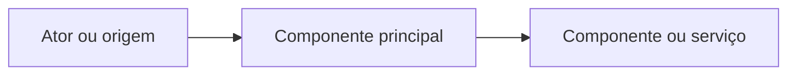

# Nome do projeto

> Uma frase curta explicando a proposta de valor do projeto.

## Sobre o projeto

### Problema

Descreva o problema ou necessidade que motivou o projeto, com base em requisitos ou documentação aprovada.

### Proposta de solução

Explique como o projeto pretende resolver o problema e quais são suas principais capacidades.

> **Estágio:** Documentação apenas / Implementação inicial / Implementado / Híbrido.
> Ajuste a identificação ao estado real. Em projeto sem código, deixe explícito que a solução e a arquitetura são propostas.

## Arquitetura

Descreva brevemente os componentes e suas responsabilidades.



Substitua o exemplo por um diagrama derivado da arquitetura documentada ou observada. Não mantenha componentes ilustrativos como se fossem reais.

## Tecnologias

| Tecnologia | Finalidade | Estado |
|---|---|---|
| A definir | A definir | Não decidida |

## Pré-requisitos

Liste ferramentas e versões confirmadas. Se ainda não estiverem definidas, registre a pendência.

## Ambiente local

Explique como preparar e iniciar o projeto.

### Opção com containers

Inclua apenas se houver configuração suportada no repositório. Informe os comandos confirmados e os serviços iniciados.

### Execução local

Inclua os passos e comandos confirmados para instalar dependências e iniciar os componentes.

## Configuração

Liste variáveis de ambiente conhecidas, sem valores secretos.

| Variável | Finalidade | Obrigatória? | Exemplo seguro |
|---|---|---|---|
| `VAR_EXEMPLO` | Descrever | A confirmar | `valor-ilustrativo` |

Se existir um arquivo de exemplo, explique como utilizá-lo. Nunca inclua credenciais reais.

## Build e testes

```bash
# Substitua por comandos verificados do projeto.
```

Explique os testes disponíveis e como executá-los. Se ainda não houver código/testes, registre como não aplicável ou a definir.

## Estrutura do projeto

Descreva apenas os diretórios e módulos relevantes para orientar a navegação.

## Documentação complementar

- Escopo e requisitos:
- Arquitetura/decisões:
- Guia de contribuição:
- Outros:
