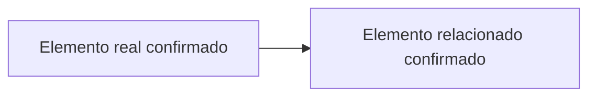

# Nome do projeto

> Resumo em uma frase: o que é, para que serve ou qual resultado produz.

## Visão geral

Explique o contexto, o propósito e o público/consumidor do projeto. Adapte o texto à natureza do repositório.

## Problema e proposta

Descreva a necessidade atendida, a proposta, os principais resultados e os limites conhecidos.

## Estado atual

Informe o estágio e diferencie o que existe/foi observado do que está especificado, proposto ou planejado.

## Estrutura e relações

Apresente os principais artefatos, componentes, responsabilidades, dependências ou relações relevantes ao tipo de projeto.

Inclua um diagrama Mermaid somente quando houver evidência e ganho de entendimento:

Substitua os marcadores por elementos reais e verificados, ou remova o exemplo.

## Fluxos e procedimentos principais

Explique como os principais elementos interagem ou como o trabalho é realizado. Considere Mermaid para sequências, processos, estados ou relações, somente quando útil.

## Pré-requisitos e configuração

Inclua somente ferramentas, versões, parâmetros e pré-condições confirmados. Não exponha valores secretos.

## Preparação e uso

Descreva como preparar, acessar, reproduzir, executar ou utilizar o projeto conforme sua natureza. Omita esta seção quando não houver procedimento aplicável.

## Validação e manutenção

Descreva como verificar resultados, executar testes, validar artefatos, atualizar ou manter o projeto, somente quando houver processo documentado.

## Organização do repositório

Explique os diretórios, arquivos ou grupos de artefatos que ajudam uma pessoa nova a navegar.

## Como contribuir ou continuar o trabalho

Apresente convenções, decisões, responsabilidades e o primeiro passo seguro, quando documentados.

## Referências

Links relativos para requisitos, decisões, manuais, especificações, contratos, catálogos ou documentação especializada.

---

**Instruções de uso do template:** adapte esta estrutura ao projeto. Não mantenha títulos sem conteúdo, exemplos genéricos, comandos não verificados ou seções que imponham tecnologias/arquiteturas inexistentes. O README deve ser suficiente para começar, mas não precisa duplicar toda a documentação especializada.
