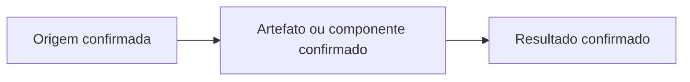
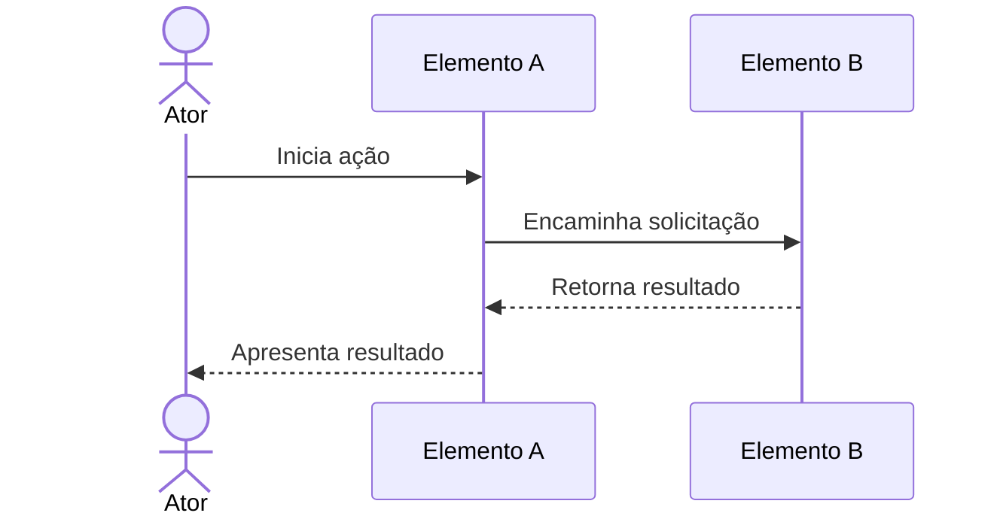
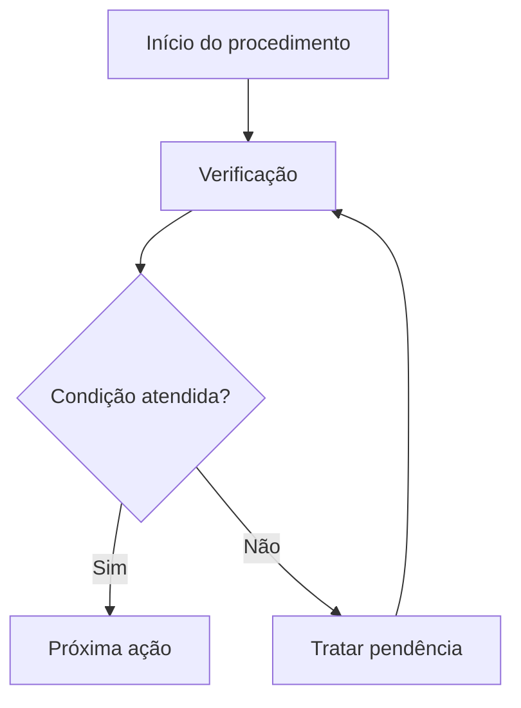

# Diretrizes Mermaid e qualidade visual do README

## Objetivo

Usar Mermaid nativo do Markdown quando a representação visual tornar o repositório mais fácil de entender, explorar, preparar, utilizar ou manter. A decisão deve ser feita em toda execução, independentemente de linguagem ou tipo de projeto.

A renderização de blocos Mermaid depende do visualizador Markdown usado pela plataforma. Não prometa suporte universal. Quando a plataforma não renderizar Mermaid, o texto e os nomes do diagrama ainda devem ser legíveis como fonte Markdown.

## Pergunta obrigatória

Ao final da auditoria visual, responda:

> **O README.md do projeto pode ser melhorado com mais diagramas Mermaid para tornar mais visual, fácil de ver e entender?**

- **SIM:** nomeie a pergunta que cada diagrama responderá, confirme as fontes e incorpore diagramas úteis ao README.
- **NÃO:** explique quais diagramas atuais já cobrem as informações importantes ou por que outro diagrama seria redundante, especulativo ou menos claro que texto/lista/tabela.

A pergunta não exige acrescentar diagramas sempre. Exige uma avaliação explícita e justificada.

## Princípio: um diagrama responde a uma pergunta

Exemplos de perguntas e representações:

- “Quais elementos compõem o projeto e como se relacionam?” → `flowchart`.
- “Como uma operação passa por participantes ao longo do tempo?” → `sequenceDiagram`.
- “Quais etapas e decisões compõem um procedimento?” → `flowchart`.
- “Quais objetos conceituais e relações são essenciais?” → `erDiagram` ou `classDiagram`, quando adequado.
- “Quais estados e transições existem?” → `stateDiagram-v2`.
- “Como artefatos, dependências ou entregas se relacionam?” → `flowchart` ou outro tipo apropriado.

Não use um tipo por familiaridade; escolha conforme a relação que precisa explicar e o suporte do renderizador.

## Exemplos de relações que podem ser visualizadas

A depender do repositório, podem agregar valor:

- visão de contexto e fronteiras;
- estrutura de componentes, módulos, arquivos ou artefatos;
- sequência de interação ou fluxo de dados;
- processo, estados ou ciclo de vida;
- dependências entre partes;
- preparação, execução, reprodução ou validação;
- navegação por documentação e entregáveis.

Essas possibilidades não são obrigatórias nem prescrevem arquitetura de software.

## Evidências

Todo nó, ator, componente, artefato, dependência, estado, transição e relação deve ser sustentado por uma fonte do repositório ou por uma especificação identificada.

Diferencie:

- **Existente/observado:** constatado no conteúdo, configuração ou operação atual.
- **Especificado/proposto:** descrito em uma fonte de planejamento ou decisão.
- **Parcial:** existe apenas parte do fluxo ou componente.
- **Desconhecido:** evidência insuficiente.

Não combine estados diferentes sem sinalização.

## Legibilidade e composição

1. Prefira diagramas pequenos, focados e posicionados perto da explicação.
2. Use nomes reais, curtos e consistentes com o repositório.
3. Mantenha direção e fluxo previsíveis.
4. Evite nós por classe, método, arquivo ou parâmetro quando não ajudarem no onboarding.
5. Divida diagramas muito grandes por perspectiva.
6. Não dependa somente de cores para comunicar significado.
7. Não exponha dados pessoais, segredos, endereços privados ou detalhes operacionais sensíveis.
8. Use legendas quando necessário para explicar tipos de estado ou fronteiras.
9. Prefira um diagrama preciso a muitos diagramas redundantes.
10. Atualize ou remova diagramas que deixaram de corresponder às evidências.

## Exemplos ilustrativos

Os nomes abaixo são marcadores genéricos e devem ser substituídos por entidades reais comprovadas antes de usar no README do projeto.

### Elementos e relações

### Interação temporal

### Processo com decisão

## Validação

- Verifique a abertura e o fechamento dos blocos `mermaid`.
- Revise identificadores, setas, aspas, delimitadores e nomes.
- Confirme cada relação contra as fontes.
- Use validador/renderizador existente, se disponível e permitido.
- Caso contrário, faça revisão estática e informe que a renderização não foi verificada.
- Não instale dependências apenas para validar diagramas.

## Antipadrões

- Diagrama inventado ou sustentado apenas por convenção tecnológica.
- Diagrama gigante e impossível de ler.
- Diagrama redundante que repete um parágrafo simples.
- Diagrama que confunde proposta com estado existente.
- Diagrama inserido só para preencher uma meta de quantidade.
- Diagrama que revela informação sensível ou interna desnecessária.
