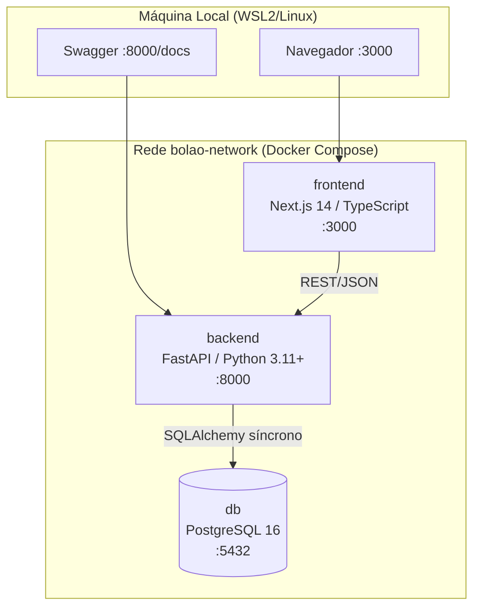
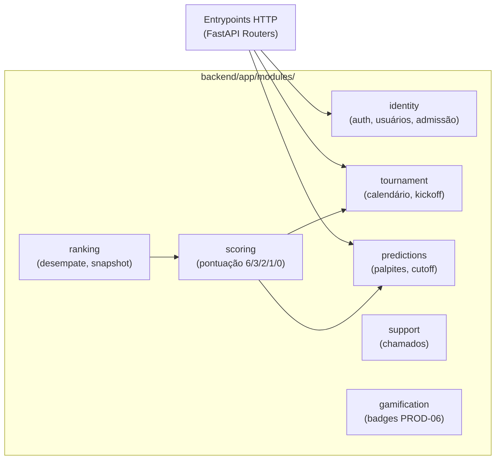

# 🏆 Onboarding — Bolão Copa do Mundo Feminina da FIFA Brasil 2027

> Documento gerado em 08/11/2026. Baseado no estado do repositório nesta data.

---

## 1. Visão Geral

### O que é o projeto

Plataforma web privada de palpites de placar para os **64 jogos da Copa do Mundo Feminina da FIFA Brasil 2027** (24/06–25/07/2027), para um único grupo fechado. Sem apostas financeiras, sem ligas públicas, sem multi-tenancy.

### Regras de negócio centrais (não violáveis)

| Pontuação | Condição |
|---|---|
| **6 pts** | Placar exato |
| **3 pts** | Vencedor/empate + gols de uma equipe exatos |
| **2 pts** | Só resultado (vitória/empate/derrota), errou ambos os gols |
| **1 pt** | Errou o resultado, mas acertou gols de uma equipe |
| **0 pts** | Nenhuma das anteriores |

- **Corte:** janela fecha **T − 1h** do kickoff (imposto pelo backend, timestamp do servidor)
- **Mata-mata:** placar ao fim de 120 minutos; pênaltis = empate
- **Fuso:** BRT (UTC−3), armazenado em UTC
- **Desempate:** placar exato → 3 pts → pontuação de rodadas anteriores → ordem alfabética

### Estágio atual

**Fundação documental + scaffold de infraestrutura.** Há **uma exceção funcional real** implementada: login administrativo local de desenvolvimento (endpoints `/admin/session`, interface frontend, testes). Todo o restante (cadastro de participantes, palpites, ranking, pontuação) está no nível de scaffold ou ainda não implementado.

---

## 2. Documentação Lida

| Arquivo | Status |
|---|---|
| `README.md` | ✅ Lido completo — bem estruturado, cobre onboarding |
| `docs/STATE.md` | ✅ Lido completo — estado operacional detalhado |
| `CLAUDE.md` | ✅ Lido (via contexto de sessão) |
| `docker-compose.yml` | ✅ Lido completo |
| `.env.example` | ✅ Lido completo |
| `backend/tests/api/test_local_admin.py` | ✅ Lido parcial |
| `docs/architecture/`, `openspec/` | 📍 Localizados, não lidos integralmente |
| `docs/requirements/requisitos-bolao-copa-mundo-feminina-2027.md` | 📍 Localizado, não lido (fonte normativa v3.4) |

---

## 3. Arquitetura

### Diagrama — Visão Geral



### Diagrama — Módulos de Domínio (Backend)



**Padrão arquitetural aprovado:** monólito modular + VSA pragmática dentro de módulos por capacidade + Clean Architecture (domain → application → adapters → entrypoints).

---

## 4. Tecnologias (Stack)

| Camada | Tecnologia | Versão |
|---|---|---|
| Frontend | Next.js / React / TypeScript | `^14` / `^18` / `^5` |
| Backend | FastAPI / Python | `>=0.100` / `>=3.11` |
| Servidor ASGI | Uvicorn | `>=0.23` |
| Validação | Pydantic v2 | `>=2.0` |
| ORM | SQLAlchemy síncrono | `>=2.0` |
| Migrações | Alembic | `>=1.12` |
| Banco | PostgreSQL | `16-alpine` |
| Qualidade backend | Ruff, Mypy, Pytest | declarados |
| Qualidade frontend | ESLint / Next Lint | declarados |
| Containers | Docker + Compose | instalados ✅ |
| Mapa de código | Graft | `0.28.1` (↑ 0.29.0 disponível) |

---

## 5. Como Começar

### Pré-requisitos

- Docker `>= 24.0` e Docker Compose `>= 2.20` ✅ (já instalados neste ambiente)
- WSL2/Ubuntu (Windows) ou Linux nativo ✅

### ⚠️ Passo obrigatório antes de subir os containers

O `docker-compose.yml` exige `LOCAL_ADMIN_PASSWORD` obrigatoriamente. Sem ela, o backend **não sobe**:

```bash
# 1. Copie o modelo de variáveis
cp .env.example .env

# 2. Defina a senha do admin local (obrigatória)
echo "LOCAL_ADMIN_PASSWORD=minha-senha-local" >> .env
```

### Subir o ambiente

```bash
# Construir e iniciar todos os serviços
docker compose up --build

# Ou em background
docker compose up --build -d

# Verificar status
docker compose ps
```

### Endereços de acesso

| Serviço | URL |
|---|---|
| Frontend (Next.js) | http://localhost:3000 |
| Backend API | http://localhost:8000 |
| Swagger/OpenAPI | http://localhost:8000/docs |
| PostgreSQL | localhost:5432 |

### Backend sem Docker (venv já criado)

```bash
# O venv Python já foi criado em backend/.venv
source backend/.venv/bin/activate

# Executar testes (requer Docker com DB rodando)
cd backend && pytest

# Lint e tipo
ruff check . && mypy app
```

> **WSL2:** Clone sempre dentro do filesystem Linux (`/home/usuario/...`), **nunca** em `/mnt/c/`. Configure `git config --global core.autocrlf input`.

---

## 6. Fluxo de Desenvolvimento — SDD + OpenSpec

Este projeto usa **Spec-Driven Development**. Nenhuma linha de código deve ser escrita sem antes:

1. Criar proposta com `/opsx:propose <nome>` → gera estrutura em `openspec/changes/`
2. Elaborar `proposal.md`, `design.md`, `tasks.md` com rastreabilidade para os requisitos
3. **Obter aprovação humana explícita** (artefatos OpenSpec não autorizam implementação)
4. Implementar com `/opsx:apply`
5. Validar com testes determinísticos (saída 0)
6. Arquivar com `/opsx:archive`

**Changes ativas no momento:**
- `2026-10-18-technical-foundation` — fundação técnica (scaffold)
- `2026-10-19-identity-email-link` — cadastro/confirmação local, **autorizado** para Task 3.2

---

## 7. O que Está Implementado (de fato)

| Item | Status |
|---|---|
| Login admin local de dev (`/admin/session`) | ✅ **Implementado** — `backend/app/modules/identity/local_admin.py` |
| Interface frontend de login admin | ✅ **Implementado** — `frontend/features/admin-login.tsx` |
| Testes do login admin | ✅ **Existe** — `backend/tests/api/test_local_admin.py` (pytest não executado/validado) |
| Healthcheck (`/live`, `/ready`) | ✅ **Existe** no bootstrap |
| Migrações Alembic | ❌ Apenas `.gitkeep` |
| Cadastro de participantes | ❌ Não implementado (Task 3.2 autorizada, pendente) |
| Palpites, pontuação, ranking | ❌ Scaffolds vazios |
| Módulos de domínio (identity, etc.) | ⚙️ Estrutura de pastas criada, sem lógica |

---

## 8. Pendências Críticas para Contribuir

| # | Pendência | Impacto |
|---|---|---|
| 1 | Validar build do Docker (nenhum `docker compose up` foi confirmado) | Sem isso não há ambiente funcionando |
| 2 | Implementar Task 3.2: cadastro/confirmação local (OpenSpec 2.1–2.2) | Next step autorizado no STATE.md |
| 3 | Testes pytest não foram executados com sucesso confirmado | Dependências instaladas no venv, mas validação real pendente |
| 4 | Alembic: nenhuma migração criada | Sem schema no banco |
| 5 | Frontend: build e lint nunca validados | `node_modules` presente, mas não verificado |
| 6 | `LOCAL_ADMIN_PASSWORD` é obrigatória no `.env` | Sem ela o backend recusa subir |
| 7 | `DATABASE_URL` ainda usa `asyncpg` no exemplo, mas ADR-001 aprovou driver síncrono | Possível incompatibilidade a resolver |
| 8 | Graft está na v0.28.1, upgrade 0.29.0 disponível | `graft upgrade` (reiniciar agente depois) |

---

## 9. Avaliação do README

O README está **completo e bem estruturado** — cobre visão geral, regras de negócio, arquitetura com diagramas Mermaid, stack, estrutura de diretórios, Docker Compose, fluxo OpenSpec e próximos passos. Não há lacunas críticas para onboarding.

Uma observação menor: a `DATABASE_URL` no `.env.example` ainda usa `postgresql://` — é necessário confirmar se o driver síncrono escolhido (psycopg, psycopg2) exige prefixo diferente (`postgresql+psycopg://`).

---

## 10. Primeiro Passo Recomendado

O caminho mais seguro para começar a contribuir:

```bash
# 1. Criar o .env com LOCAL_ADMIN_PASSWORD
cp .env.example .env
echo "LOCAL_ADMIN_PASSWORD=minha-senha-local" >> .env

# 2. Subir o ambiente e verificar se tudo sobe
docker compose up --build

# 3. Confirmar que o healthcheck passa
docker compose ps
# e acessar http://localhost:8000/docs
```

Com o ambiente rodando, o próximo passo de implementação já autorizado é a **Task 3.2** (cadastro/confirmação local de participantes, OpenSpec `2026-10-19-identity-email-link`). Leia `docs/STATE.md` antes de qualquer turno de trabalho — é a âncora cognitiva do projeto.

---

> **Dica de navegação:** Use `graft ask "<pergunta>"` para localizar código por semântica (CLI), `graft skeleton <arquivo>` para ver a API surface de um arquivo, e `/opsx:explore` para navegar pelas especificações OpenSpec ativas. Para rastrear quem chama uma função antes de alterá-la, use a ferramenta MCP `graft_trace_calls` dentro do Claude Code.
